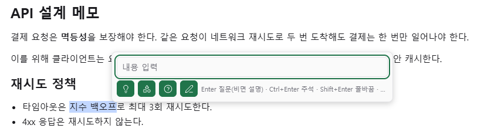
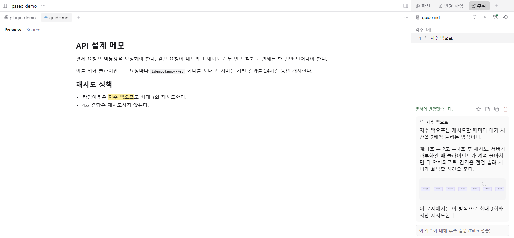
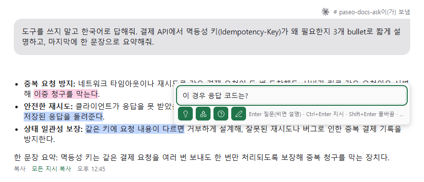

# paseo-doc-ask (문서 질문)

[English](README.md)

Markdown 문서나 에이전트 답변에서 구절을 드래그해 AI에게 설명·시각화·질문을 받고, 답을 각주로 남기는 [Paseo](https://paseo.sh) 플러그인.







## 설치

```bash
paseo plugin add git:nasus1263/paseo-doc-ask
```

데몬에서 플러그인이 켜져 있어야 한다(**Settings → Plugins → Enable plugins**). Paseo `>=0.16.0-beta.2`, 데몬 `PATH`에 npm 필요.

## 사용법

- `.md` 파일을 열고 패널 선택에서 **문서 질문**을 고른다.
- Preview에서 텍스트를 드래그하면 입력 칸이 열린다.
  - **Enter**: 질문 (비어 있으면 설명)
  - **Ctrl+Enter**: AI 없이 내 주석 저장
  - 버튼: 설명 / 시각화 / 질문 / 주석
  - 입력한 채로 보내지 않고 닫으면 **임시 각주**로 남는다(파란 구절, 누르면 이어 쓰기, 휴지통이나 내용 비우고 닫기로 삭제). AI·문서와는 무관.
- 답은 문서에 형광펜(`==구절==[^n]`)으로, 각주 본문은 옆 `<이름>.comment.md`에 저장된다.
- 사이드 **주석** 패널에서 각주 목록, 후속 질문, 북마크, 메모, 삭제.
- 에이전트 답변: Command Center(Ctrl/⌘K) → **대화 주석 켜기**. 답변에 단 지시는 다음 메시지에 자동으로 붙는다.

자세한 내용은 [OVERVIEW.md](OVERVIEW.md).

## 주의

- **파일을 수정한다**: 문서에 형광펜·각주 참조를 넣고 `*.comment.md`를 만든다.
- **Claude로 전송**: 문서 경로·내용, 선택 구절, 질문, 설정한 프롬프트가 Paseo의 Claude 프로바이더로 간다. 워크스페이스당 최대 4개의 숨김 해설 에이전트를 만든다.
- 읽기 도구는 자동 허용. 그 밖의 권한 요청은 앱에서 승인해야 하며 5분 내 응답이 없으면 거부된다.
- 선택·툴팁은 데스크톱과 웹 전용.
- 대화 주석과 지시 첨부는 Paseo 내부 화면 구조에 의존하므로 업데이트 시 깨질 수 있다(기본 꺼짐).
